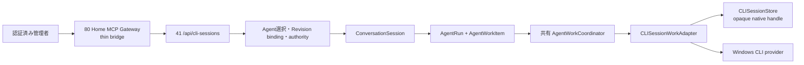

# AoiTalk CLI継続セッション運用手順

この文書は、AoiTalkが所有するCodex CLI、Claude Code、Grok Build、Antigravity CLIのnative継続セッションを、41の共通Agent/Conversation/Run/Work基盤から運用するための手順です。既定では無効です。Windows host CLIを直接実行するtrusted Windows laneはOS sandboxではなく、Windowsユーザーの権限で動く明示opt-inの実行経路です。

この文書の運用対象は `src/api/cli_development_session_routes.py`、`src/services/cli_development_sessions.py`、`src/services/cli_session_work_adapter.py`、`src/llm/cli_sessions.py` の契約です。設定の既定値は `src/config_defaults.py`、実際のグローバル設定はDBの `app_config_settings` を正本にします。

現在の4CLIの直接実行版は、AGY 1.4.2、Claude Code 2.1.302、Codex CLI 0.163.0-alpha.10.2、Grok Build 1.0.62です。隔離workspaceで各CLIの2ターンnative resumeを確認し、実4CLI API → 80 Gateway strong run（別SQLite）、PostgreSQL harness（fake provider transport）、actual live disconnect/cancel、独立UI QAを別stackで実証しました。通常UI stream sendと現在接続中Dotのtool catalog refreshは未実施です。native defaultのAGY/Claude拒否、Codexのread-only/MCP approval調査は履歴として残し、選択permission profileのdirect実証ではprovider permission denial 0でした。

## 実行境界



80のthin bridgeはCLI executable、LLM loop、provider native handle、session storeを所有しません。80は認証済み41 APIへ1リクエストずつ転送し、公開するのはboundedなsession/status/event projectionだけです。session ownership、Agent binding、provider execution、cancel、reconnectの意味は41が正本です。41 APIが停止した場合、80は別providerやstateless実行へfallbackしません。

通常のtrusted Windows laneと、AgentRunScope下のWSL2/bubblewrap laneを混ぜません。前者は `cli_development_sessions.trusted_windows` の明示許可を再検証してWindows host CLIを実行します。後者は `CLIBackendBase` が管理する別のscopeで、WSL+bwrapのworkspace境界を使います。trusted Windows laneへAgentRunScopeから入ると `trusted_windows_scope_conflict` で拒否されます。trusted Windows policyの `sandbox` はfalseであり、OS sandboxの代替とは扱いません。

80から41 Agentへ委譲する別経路では、80の `local_agent_read_only` stdio childを使います。このprofileは `list_directory`、`path_info`、`read_text`、`search_text` の4 read-only toolだけを公開し、CLI session toolを再公開しません。80からCLI継続sessionを使う場合は通常の `HOME_MCP_AOITALK_ENABLED=1` 経路を使います。

## 現在の既定値と有効化

`src/config_defaults.py` の現在の既定値は次のとおりです。fresh installではこのままfail-closedになります。

```yaml
cli_development_sessions:
  enabled: false
  trusted_windows:
    enabled: false
    execution_lane: trusted_windows
    allowed_roots: []
    allowed_owner_ids: []
    allowed_agent_ids: []
    provider_cache_roots: {}
    allowed_permission_modes:
    - native_default
```

有効化する場合は、productionへ反映する前に管理者が現在のAgent/Revision、owner、絶対workspace root、provider cache root、Windows CLIの認証状態を確認します。設定例は次の形です。値は必ず実環境の正本から取得し、IDやpathを推測しません。

```yaml
cli_development_sessions:
  enabled: true
  trusted_windows:
    enabled: true
    execution_lane: trusted_windows
    allowed_roots:
      - <ABSOLUTE_TRUSTED_WINDOWS_ROOT>
    allowed_owner_ids:
      - <OWNER_UUID>
    allowed_agent_ids:
      - <AGENT_UUID>
    provider_cache_roots:
      codex-cli: <ABSOLUTE_CODEX_CACHE_ROOT>
      claude-cli: <ABSOLUTE_CLAUDE_CACHE_ROOT>
      grok-cli: <ABSOLUTE_GROK_CACHE_ROOT>
      antigravity-cli: <ABSOLUTE_AGY_CACHE_ROOT>
    allowed_permission_modes:
      - native_default
```

運用設定は `cli_development_sessions.trusted_windows` 配下へ置きます。fresh defaultの `allowed_permission_modes` は `native_default` だけです。`standard`や`accept_edits`を使う場合は、trusted Windowsのallow-listへそのmodeを明示的に追加します。`allowed_owner_ids` が空のままでは拒否されます。`allowed_agent_ids` は空ならAgent単位の追加allowlistを使わず、値があれば一致したAgentだけを許可します。`allowed_roots` はcanonicalな既存ディレクトリでなければならず、symlink、junction、reparse path、root外のcwdは拒否されます。providerごとのcache rootはsession作成時に明示的に必要で、未設定・reparse pathは拒否されます。

この設定はfeature flagだけでは実行許可になりません。毎回、Windows platform、lane、owner allowlist、Agent allowlist、cwd、cache root、Agent authority、immutable binding、provider/model/effort route、permission modeを再検証します。

## 設定の正本と優先順位

AoiTalkの設定は次の順で読みます。

1. `.env`を読み込み、deployment secret fileを再適用してprofile/environment選択と環境変数を確定する。
2. `config/config.yaml`またはprofileのoverlayをdefault seedへマージする。profile overlayは初回DB seedに使われます。
3. `app_config_settings`の既存global rowを読み、存在するkeyはDB保存値を正本にする。欠落keyだけseed/defaultで補います。
4. `Config._merge_env_variables` のdeployment環境変数を最後に適用する。path値は展開されます。
5. `cli_development_policy` が `cli_development_sessions.trusted_windows` のnested policyを読み、deploymentの `allowed_permission_modes` とcreate requestの `permission_mode`（既定 `native_default`）を照合し、session contextへ固定します。実際にCLIへ渡ったmodeはprovider diagnosticsで確認します。

既存DB rowがある環境でYAMLやdefaultを編集しても、既存値は自動で置き換わりません。`/api/settings`の現在のallow-listには `cli_development_sessions` がないため、このbranchはWeb設定PATCHの対象にしません。承認済みbranch全体を管理者が確認した上で、repo rootの`venv` Pythonから `Config.save_to_file("cli_development_sessions", branch)` を1回だけ呼ぶ既存local運用を使います。`src/config.py:576-623`の`save_to_file`は名前に反してファイルへ直接書かず、`update_app_config_key_sync`でDBの `app_config_settings` を更新してから実行中Configを更新します。既存branchを自動mergeせず、candidateはbranch全体を提示し、現在値のhashを照合してから保存します。

次の例は保存コマンドの形だけを示します。このタスクでは実行しません。production設定を変更する場合は、候補ファイルと現在値を人間が比較し、確認済みの保存操作だけに`--apply`を付けます。候補ファイルはJSONまたはPyYAMLで、`cli_development_sessions` branchだけを含め、`trusted_windows`以外のflat fields、`permission_mode`、`approval_policy`を含めません。dry-runは末尾の`--apply`を外して実行し、保存時だけ付けます。dry-runではDBを書き換えず、`--apply`時だけ承認済みbranch全体を保存します。

```powershell
$branchFile = 'D:\path\to\approved-cli-development-sessions.json'
$expected = '<SHA256_OF_CURRENT_CLI_DEVELOPMENT_SESSIONS_BRANCH>'
$env:EXPECTED_CLI_DEVELOPMENT_SESSIONS_SHA256 = $expected

@'
import hashlib
import json
import os
import sys
from pathlib import Path

import yaml

from src.config import Config

path = Path(sys.argv[1])
apply = '--apply' in sys.argv[2:]
raw = path.read_text(encoding='utf-8')
candidate = yaml.safe_load(raw) if path.suffix.lower() in {'.yaml', '.yml'} else json.loads(raw)
if not isinstance(candidate, dict):
    raise SystemExit('candidate must be an object')
branch = candidate.get('cli_development_sessions')
if not isinstance(branch, dict) or set(branch) != {'enabled', 'trusted_windows'}:
    raise SystemExit('candidate must contain only cli_development_sessions.enabled/trusted_windows')
trusted = branch['trusted_windows']
allowed = {'enabled', 'execution_lane', 'allowed_roots', 'allowed_owner_ids',
           'allowed_agent_ids', 'provider_cache_roots', 'allowed_permission_modes'}
if not isinstance(trusted, dict) or not set(trusted).issubset(allowed):
    raise SystemExit('trusted_windows contains an unsupported field')

config = Config()
current = config.get('cli_development_sessions', {})
current_bytes = json.dumps(current, ensure_ascii=False, sort_keys=True, separators=(',', ':')).encode()
current_hash = hashlib.sha256(current_bytes).hexdigest()
print(json.dumps({'current_branch_sha256': current_hash,
                  'candidate_enabled': bool(branch.get('enabled')),
                  'apply': apply}, ensure_ascii=False))
if current_hash != os.environ.get('EXPECTED_CLI_DEVELOPMENT_SESSIONS_SHA256'):
    raise SystemExit('current branch changed; stop and re-review')
if not apply:
    raise SystemExit('dry run complete; rerun the reviewed command with --apply')
if not config.save_to_file('cli_development_sessions', branch):
    raise SystemExit('save_to_file failed')
print(json.dumps({'saved': True, 'restart_required': True}, ensure_ascii=False))
'@ | .\venv\Scripts\python.exe - $branchFile --apply
```

`save_to_file`成功後もAoiTalk API、shared coordinator、workerを自動再起動しません。通常restart後に `/api/cli-sessions/status`、provider readiness、`state_root`/`state_root_source`、effective permission modeを再確認します。失敗・hash不一致・restart未実施は反映完了と扱いません。作業中の`.env`、認証、global provider configはこの手順から変更しません。

provider state rootはscope fingerprintだけのラベルではなく、CLI childが実際に読むstate/config/session/cacheのrootです。trusted Windows laneでは、serviceが`CLIInvocationOptions.provider_state_root`へ渡した値をCodex/Claude/Grokの`CLIBackendBase.get_subprocess_env`がper-invocation環境へ投影します。これはプロセス全体の環境変数やglobal provider設定を変更しません。適用後のsafe diagnosticsには`state_root`と`state_root_source`を記録し、provider側のeffective sourceも確認します。次の表はtrusted Windows laneの実装契約です。

| provider | Windows既定root | 正式なroot切替 | 運用上の判定 |
|---|---|---|---|
| Codex | `%USERPROFILE%\.codex` | `CODEX_HOME` | configured rootをchild環境へ渡し、`state_root_source=invocation`とCLIのeffective sourceを確認 |
| Claude Code | `%USERPROFILE%\.claude` | `CLAUDE_CONFIG_DIR` | settings、credentials、session history、pluginsを含むrootをchild環境へ渡し、`state_root_source=invocation`とeffective sourceを確認 |
| Grok Build | `%USERPROFILE%\.grok` | `GROK_HOME` | configとsession rootをchild環境へ渡し、`state_root_source=invocation`と`grok inspect`相当のsourceを確認 |
| AGY | `%USERPROFILE%\.gemini\antigravity-cli` | full state rootの公式relocationを確認できない | configured rootはWindows default `%USERPROFILE%\.gemini\antigravity-cli` と一致する場合だけ許可。`AGY_APP_DATA_DIR`はAoiTalkのtranscript fallback用でCLI state relocationとは扱わない |

AGYにはこのrootを切り替えるprovider環境変数を設定せず、adapterが既定Windows rootとの一致を検証します。scope fingerprintが一致していても、`state_root`と`state_root_source`でconfigured rootの適用を確認できない場合はsessionを実行しません。AgentRunScope下の既存WSL+bwrap経路のguest rootをこの設定で変更する契約ではなく、ここで扱う正式運用はtrusted Windows laneに限ります。

## Agent、Revision、authorityの準備

1. 認証済み管理者として `GET /api/agents` で対象Agentを一覧し、返された `agent_id` を使います。Agentを新規作成する場合は既存の `POST /api/agents` と `Idempotency-Key` を使います。
2. `GET /api/agents/{agent_id}/revisions` でactiveまたは運用対象のRevisionを確認します。Revisionが必要なら `POST /api/agents/{agent_id}/revisions` で `display_name`、`agent_team_id`、`execution_profile_id`、capability ceiling、idempotency keyを登録し、公開・有効状態を確認します。
3. Revisionの正準routeからprovider、model、effortを取得します。CLI sessionのcreate requestに別の値を指定すると、推論開始前に `agent_route_mismatch` で拒否されます。保存済みの全体default modelを使ってrouteを暗黙に差し替えません。
4. `GET /api/agents/{agent_id}/effective-authority?revision_id=<REVISION_ID>&required_capability=...` をcapabilityごとに確認します。CLI session serviceが要求するcapabilityは現在 `command_execute`、`workspace_read`、`workspace_write` です。authority resolverがいずれかをdeny、unavailableにした場合はsessionを作成しません。
5. session作成時に41がAgent bindingを作成し、AgentRevision、binding snapshot hash、authority digest、capability manifest digest、policy fingerprint、provider cache rootをnative continuation scopeへ固定します。provider-owned native handleはserver内部だけに保存し、80/MCP、status projection、UIへ返しません。

provider native handleは `ConversationSession.context.cli_native_sessions` にboundedに保持されます。branch、provider、model、project、cwd、settings fingerprint、Agent Revision、binding hash、authority、policy、cache rootが一致する場合だけresumeできます。leaseが生きている同一sessionへ並列sendはできません。native resume失敗は新規startやstateless retryへ変換せず、`disconnected` / `native_session_disconnected` として扱います。

## 41 APIの手順

全CLI session routeはcookie認証済みのadministrator human専用です。feature disabledまたはservice未attachの場合、status route以外はfail-closedで409になります。

| 操作 | HTTP | 必須引数 | 用途 |
|---|---|---|---|
| status | `GET /api/cli-sessions/status` | なし | feature、trusted Windows、root、permission mode、service availabilityの診断。providerを起動しない |
| create | `POST /api/cli-sessions` | `agent_id`, `provider`, `model`, `working_directory`, `idempotency_key` | ConversationSessionとbindingを作り、provider turnは起動しない |
| send | `POST /api/cli-sessions/{session_id}/messages` | `message`, `idempotency_key` | 生のmessageをtrim/normalizeせず、1 turnのAgentRun/Workをqueueする |
| list | `GET /api/cli-sessions?limit=<N>&status=<STATUS>` | なし | durable session一覧。providerを起動しない |
| status | `GET /api/cli-sessions/{session_id}` | `session_id` | session、latest Run/Work、native stateのsafe projection |
| tail | `GET /api/cli-sessions/{session_id}/events?after=<OPAQUE_CURSOR>&limit=<N>` | `session_id` | 1 sessionのbounded event page |
| collect | `POST /api/cli-sessions/collect` | `cursors` map | 複数sessionをcursor mapで巡回 |
| cancel | `POST /api/cli-sessions/{session_id}/cancel` | `session_id` | active Runへcancel requestを送り、`cancelling` → process drain →終端状態を再取得 |
| reconnect | `POST /api/cli-sessions/{session_id}/reconnect` | `session_id` | provider native continuationを再照合。messageを再送しない |

`create`のproviderは `codex-cli`、`claude-cli`、`grok-cli`、`antigravity-cli` です。実効permission modeの正本はcreate requestの `permission_mode`（既定 `native_default`）で、deploymentの `allowed_permission_modes` と照合した後にsessionへpinされます。fresh defaultのallow-listは `native_default` だけです。`standard`や`accept_edits`を使う場合はnested trusted Windows policyへ追加します。`effort`はAgent Revisionのrouteと一致させる場合だけ渡します。

80 Gatewayから呼ぶ場合、`create`と`send`の `idempotency_key` はMCP bodyとHTTP `Idempotency-Key` headerの両方へ渡されます。通信結果が不明なら同じkeyで照合し、別keyでduplicate create/sendを送らないでください。`submission_uncertain=true` は処理完了を意味しません。まずstatus、events、必要ならreconnectを確認します。API、Gateway、workerの再起動後にstale claimやleaseの状態が不明な場合もuncertainとして扱い、status/eventsと永続Run/Workを照合するまでblind replayしません。

## permission modeとproviderの変化

per-invocation `CLIInvocationOptions`を使い、プロセス全体の環境変数やglobal provider設定を変更しません。現在のbackend mappingは次のとおりです。

| AoiTalk mode | AGY | Claude Code | Grok Build | Codex CLI |
|---|---|---|---|---|
| `native_default` | provider保存のnative defaultを使う。`AGY_AUTO_APPROVE`をmanual laneへ持ち込まない | `--permission-mode`を追加せず、provider保存設定を使う | permission flagを追加せず保存設定を使う | approval/sandbox flagを追加せず、provider保存設定を使う |
| `standard` | `--mode default` | `--permission-mode default` | `--permission-mode default` | `-c approval_policy="never"` + `--sandbox workspace-write` |
| `accept_edits` | requested/appliedは`--mode accept-edits`。observed表記は別途確認 | `--permission-mode acceptEdits` | 使用不可。backendが拒否 | 使用不可。backendが拒否 |

AGYのstrong runでは、AoiTalkのrequested modeは`accept_edits`、adapterが組み立てたapplied flagは`--mode accept-edits`でした。一方、CLIのobserved/diagnostics表記は`request-review`でした。installed helpと既存sourceからこのinit/display名の意味を`accept_edits`と同一視する根拠は確認できていないため、requested・applied・observedを分離して記録し、実効mode一致とは断言しません。file edit成功とpermission denial 0は機能結果として別に記録します。Claudeではrequested/applied/observedが`acceptEdits`系で一致しました。

`accept_edits`はAGY/Claudeのfile editを対象にした明示運用です。shell/network許可を意味しません。providerのallow rulesやMCP設定が必要な操作は別途provider側で明示します。`--dangerously-skip-permissions`、`--always-approve`、Codexの`--dangerously-bypass-approvals-and-sandbox`は標準手順にしません。

承認の記録は二つの層を分けます。

- 41のWork adapterはprovider eventをbounded metadataとしてRun/Work ledgerへ記録し、`waiting_approval`、`waiting_input`、`cancelling`、`disconnected`、`interrupted`を状態へ反映します。AoiTalkの承認UI request数は別に記録します。
- CLI側はproviderのpermission prompt、`permission_denied`、headless soft-deny、stderr noticeを返します。AGYのようにstdout `SUCCESS`でもstderrにsoft-denyが出る場合があるため、成功判定はstdoutだけで行いません。

Codexではfilesystem sandboxのwriteとMCP tool approvalは別経路です。Windows `unelevated` sandboxで`--sandbox workspace-write`を指定しても、`approval_policy=never`のMCP readはapproval requiredで拒否されることがあります。これはCodexのnative file writeが許可されないことを意味しません。両方をturn evidence、Run/Work event、実ファイルで確認します。

## 80 thin bridgeの接続とrefresh

80 `D:\Dev\80_HomeMCPGateway` の通常AoiTalk連携は、既存のローカル`.env`認証を使い、秘密値をMCP引数・prompt・ChatGPT接続設定へコピーしません。通常の準備は次の順です。

1. 41 APIが稼働し、`GET /api/cli-sessions/status` が設定・service availabilityを示すことを確認します。CLI providerを80上で直接起動しません。
2. 80の既存`.env`で `HOME_MCP_AOITALK_ENABLED=1` を有効にし、既存のAoiTalk base URL・認証設定をplaceholderのまま運用者だけが確認します。実値はこの文書・MCP引数・ログへ書きません。
3. 80の通常Gatewayを `scripts/connect_tunnel.ps1` で起動し、runtimeの `process_running`、`healthy`、`ready` を確認します。起動用consoleはWindows規約に従いhiddenで扱います。
4. ChatGPT側の接続はTunnel + No authenticationのGateway metadataを使います。runtime API keyはtunnel-clientとOpenAI間だけで使い、ChatGPTへ渡しません。
5. 新しい8 toolsやschemaが見えない場合、runtimeを正常にした後、公式の [Refresh MCP metadata](https://developers.openai.com/plugins/deploy/connect-chatgpt#refresh-metadata) を実行し、ChatGPTの対象接続で `Refresh` / 「ツールを更新」を行います。新しい会話でtool catalogを再確認します。

現在稼働しているAoiTalk、Gateway、Tunnel、model serverを他taskの作業中に再起動しません。production反映は、他taskの終了確認後に通常のservice restart → readiness → Gateway再接続 → metadata refresh → 新規会話でtool再確認の順に行います。今回の作業ではglobal設定変更、service restart、production反映を行っていません。

## 8 toolsの最小呼出し表

80が公開するtool名は `aoitalk_cli_session_create`、`aoitalk_cli_session_send`、`aoitalk_cli_session_list`、`aoitalk_cli_session_status`、`aoitalk_cli_session_collect`、`aoitalk_cli_session_tail`、`aoitalk_cli_session_cancel`、`aoitalk_cli_session_reconnect` です。

| tool | 必須引数 | 最小動作 |
|---|---|---|
| `aoitalk_cli_session_create` | `agent_id`, `provider`, `model`, `working_directory`, `idempotency_key` | sessionを作るだけ。provider processは起動しない |
| `aoitalk_cli_session_send` | `session_id`, `message`, `idempotency_key` | 1 turnをqueueする。messageはそのまま渡す |
| `aoitalk_cli_session_list` | なし | `limit` 1–200、任意status |
| `aoitalk_cli_session_status` | `session_id` | session/Run/Workのsafe projection |
| `aoitalk_cli_session_collect` | `cursors` | 最大200 sessionのcursor map、各limit 1–500 |
| `aoitalk_cli_session_tail` | `session_id` | `after`はopaque cursor、limit 1–500 |
| `aoitalk_cli_session_cancel` | `session_id` | `cancelling`、process drain、終端status/eventsを確認 |
| `aoitalk_cli_session_reconnect` | `session_id` | 状態照合だけ。messageを再送しない |

`session_id`、native session handle、lease、credential、環境変数をMCP側で再構成しません。MCPが返すsession_idはAoiTalk APIが公開したopaque IDです。

## 複数sessionのcursor巡回

最初の`tail`で各sessionのcursorを取得し、以後は同じsessionに同じcursorを戻します。複数sessionは`collect`でまとめられます。

```json
{
  "cursors": {
    "<SESSION_ID_A>": "<OPAQUE_CURSOR_A>",
    "<SESSION_ID_B>": "<OPAQUE_CURSOR_B>"
  },
  "session_ids": ["<SESSION_ID_A>", "<SESSION_ID_B>"],
  "limit_per_session": 100
}
```

応答に `next_cursor` がある場合だけ、該当sessionのcursorを置き換えます。`output_truncated=true` または `cursor_advance_blocked=true` の場合はcursorを進めず、event limitまたは一度に取得するsession数を減らして、同じcursorで再取得します。`collect`で一部sessionが失敗しても、成功したsessionのcursorを他sessionへ流用しません。

イベントcursorはv3です。cursorはopaqueなbase64url文字列ですが、41内部では次の情報を持つ固定形式として検証されます。

```json
{"version":3,"session_id":"<SESSION_ID>","sequence":42}
```

`session_id`が一致しないcursor、v3以外のcursor、sequenceを整数として読めないcursorは`invalid_event_cursor`になります。イベントはWork/Run単位の`sequence`とは別にsession全体の`session_sequence`で並びます。`cli_session_sequence`が付かない古い/別経路のeventはsession feedへ混ぜません。

`cli.output`のpayloadは次のbounded projectionです。長文全文やprovider raw payloadを返しません。

| field | 意味 |
|---|---|
| `assistant_message_id` | 暗号化ConversationMessageを参照するID |
| `chunk_index`, `chunk_count` | 出力分割の位置と総数 |
| `start`, `end` | 保存本文の文字位置 |
| `text`, `text_end`, `text_truncated` | bounded sliceと切り詰め結果 |
| `cli_session_sequence` | session全体のfeed sequence |
| `error_code` | terminal/error eventのsafe code |

1回のevents pageは最大500 event、JSON pageは64 KiB、1 output chunkは16 KiB以内です。Gatewayのmessageは100,000文字、event limitは1–500、複数sessionのcursor mapは最大200件です。page budgetで一部を返せない場合はcursorを進めず、`cursor_advance_blocked=true` を確認して同じcursorを再取得します。

## session作成から完了まで

1. `/status`でfeature、trusted Windows、root、permission mode、service availabilityを確認する。
2. Agent catalogで `agent_id` を選び、Revision一覧と正準routeを再読する。
3. Agent authorityをcapabilityごとに確認し、`command_execute`、`workspace_read`、`workspace_write`が許可されることを確認する。
4. `create`を一意のidempotency keyで送る。`accepted`/`created`はprovider起動や完了を意味しない。
5. 直後に`status`を再取得し、sessionが`ready`でprovider turn未起動であることを確認する。`ready`を確認してから`send`を送り、`queued` → `running`を確認する。
6. `tail`または`collect`をcursorで巡回し、`cli.output`、`waiting_approval`、`waiting_input`、`cancelling`、`completed`、`failed`、`disconnected`を確認する。
7. network断や応答不明ではまずstatus/eventsを再取得する。再試行が必要な場合は同じsend keyと同じ本文だけを使い、新しいkeyでduplicate sendを作りません。native continuationの再照合が必要な場合だけ`reconnect`を使います。
8. 完了・取消・切断後はprocess drainを待ち、Run/Workがterminalへsettleしたことを確認する。`cancelling`のまま再送や再接続を重ねません。sessionのprovider handleはMCPやログへ出さない。
9. `cancelled`後にstatusで`native_handle=confirmed`（provider-owned native stateがactive）と`safe_to_send=true`を確認した場合だけ、利用者が明示した新しいsendを次のturnとして開始できます。これは暗黙のretryではなく、未確認handleやuncertainのcancel後には許可しません。

## 実証範囲と未実施

2026-10-18に、provider direct、41 API、80 Gateway、独立UI stackを分けて実証しました。結果は次の通りです。

| 実証 | 結果 | 確認内容 |
|---|---|---|
| 4CLI trusted Windows raw direct | PASS | AGY/Claude/Codexのstrong nonce、Grok parser修正後のnonceを、nonceをファイルへ書かない2 turnで確認。4CLIともnative continuation、marker、permission denial 0。AGYのrequested/applied/observed mode一致は未確定。 |
| 4CLI API → 80 Gateway strong run（SQLite） | PASS | 実4CLIのtyped session、native resume、nonce、marker、events、cursor巡回、permission denial 0を確認。provider direct実証と別のAPI→Gateway経路です。 |
| 41 API → 80 Gateway PostgreSQL harness（fake provider transport） | PASS | 4 typed session、create/sendのsame-key idempotency、同一send keyのcross-concurrent exactly-once、cursor SQL delta/empty repeat、native reconnect、cancel terminalを専用schemaで確認。provider実LLMの証明とは分けて扱います。 |
| actual live Gateway disconnect | PASS | Claudeの同一CLI process identityがGateway切断前後で維持され、Runは`running`を維持。再接続後にcancelし、`cancelling` → process gone → DB Run/Work `cancelled`まで確認。 |
| Claude actual live final sequence | PASS | 1turn完了 → 2turn running中のGateway切断・再接続 → cancel → process gone/DB Run・Work `cancelled` → reconnectで`safe_to_send=true` → 新keyの3turn succeeded。nonceはファイルへ書かず、3turn回答で1turn nonce記憶とDB raw input hashを確認。 |
| 独立UI QA isolated stack | PASS | Grok実streamの末尾chunk `RAW_CAPTURE_OK`、full bubbleの保存・再読込、通常テキスト履歴を別AIで確認。 |

上記の選択permission profileではprovider permission notice/denial 0、親側のtool approval UI request 0でした。Dot接続側のtool approval設定は未検証です。初期native defaultでAGYとClaudeのpermission/Write拒否が各1回あり、Codexの`--ignore-user-config`時のread-only化とMCP approval要求は別の監査履歴として残します。dangerous bypassは使いません。

通常UIからのstream sendと、現在接続中のDotでのtool catalog refreshはこの受入範囲に含めていません。source保存configの変更、稼働中service/Tunnelのrestart、productionでのfeature enableは行っておらず、feature defaultはOFFです。production反映は他taskの終了確認後に、通常restart、readiness、Gateway reconnect、metadata refresh、新規会話でのtool catalog確認を順に実施します。

raw stdout/stderr、個人ID、native ID、auth path、process ID、session handleは本文へ貼らず、検証報告と`.local`の一時証拠だけに置きます。統合実証のPASSは専用の隔離stackと専用DB schemaに対する結果であり、production反映完了を意味しません。

## 2026-10-19の承認済みローカル反映

上の2026-10-18隔離実証時点ではproduction反映を行っていませんでした。その後、ユーザーの明示許可に基づき、ローカル環境に専用4 Profileと4 Agentを用意し、各Revision 2を既存`workspace_operator`へ接続しました。capability ceilingは`workspace_read`・`workspace_write`・`command_execute`の3つ、wakeはmanualです。owner 1件・Agent 4件・対象repository 8件・既存state root 4件・permission mode `standard` / `accept_edits`に限定して有効化しました。Organizationや汎用Subagentの能力、既存CLI認証とglobal permission設定は変更していません。

対象8 repositoryのproject設定へ`sandbox_workspace_write.network_access=true`を追加しました。これは設定の保存確認であり、全CLI・全作業のネット取得やgit pushの実行保証ではありません。79/91は変更許可対象に追加していません。cwd allowlistもOSの書込み隔離とは区別します。

Codexは実CLI cacheの対応情報に基づいてカタログへ`gpt-6-luna / max`を登録し、正準routeと独立実UIで値・再読込保持を確認しました。既存5.6のpresetや既存sessionは変更していません。この組合せでの新たな実CLI 2ターン確認は未実施です。

41は既存`run.bat`の終了コード42による通常再起動、80は認証環境を読み込んだ本体`run`の可視Windows Terminalへ反映しました。41のCLI service availability、80のhealth/readiness、server側fresh stdioの92 tools中のCLI 8 toolsを確認しました。dot側のmetadata更新は別操作です。

優先したAGYは、新規検証sessionだけでproductionの2ターンを確認しました。第1指示のnonceを第2指示で再提示せずに復唱し、DB上のnative `start` / `resume`、2 Runの成功、同一keyの重複防止、cursor差分回収、permission/input/denial各0を確認しました。現在進行中の既存taskは再送していません。AGYのmode観測表示名`request-review`と指定`accept_edits`の違いは引き続き分離して記録します。

## 公式一次情報

- [Antigravity CLI headless](https://antigravity.google/docs/cli/headless/)
- [Antigravity permissions](https://antigravity.google/docs/permissions/)
- [Claude Code CLI reference](https://code.claude.com/docs/en/cli-reference)
- [Claude Code headless](https://code.claude.com/docs/en/headless)
- [Claude Code environment variables](https://code.claude.com/docs/en/env-vars)
- [Codex config basics](https://learn.chatgpt.com/docs/config-file/config-basic)
- [Codex environment variables](https://learn.chatgpt.com/docs/config-file/environment-variables)
- [Codex CLI reference](https://learn.chatgpt.com/docs/cli/reference)
- [Codex Windows sandbox](https://learn.chatgpt.com/docs/windows/windows-sandbox)
- [Grok Build headless](https://docs.x.ai/build/cli/headless-scripting)
- [Grok Build sessions](https://docs.x.ai/build/features/sessions)
- [Grok Build permissions](https://docs.x.ai/build/features/permissions)
- [Grok Build settings](https://docs.x.ai/build/settings)
- [Antigravity IDE settings](https://antigravity.google/docs/ide-settings?authuser=01)
- [MCP metadata refresh](https://developers.openai.com/plugins/deploy/connect-chatgpt#refresh-metadata)
